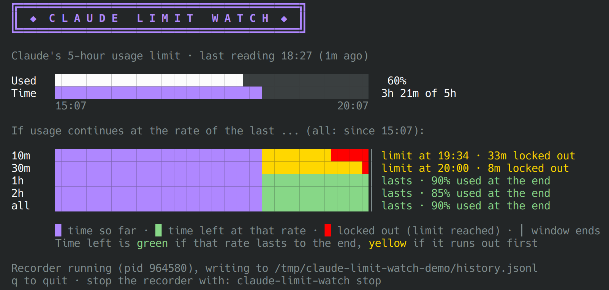

# claude-limit-watch

Watch the Claude subscription's 5-hour usage limit.

**Unofficial.** claude-limit-watch isn't made, endorsed or supported by
Anthropic. It reads your usage from an undocumented endpoint, which may
change or stop working at any time. It uses the OAuth token Claude Code
stores on your machine, and sends it only to `api.anthropic.com`.

## Installation

    gem install claude-limit-watch

It uses only the Ruby standard library (Ruby 2.6+), so it runs on macOS's
system Ruby. Normally you just run the viewer:

    claude-limit-watch [view] [rate-window-minutes]
        [--lines] [--once] [--no-record] [--utc] [--file PATH]

It starts a background recorder if one isn't running (unless `--no-record`
or `--once`), then shows the readings. `claude-limit-watch --help` lists
all the commands and options, and `--version` shows the version. Two
processes are involved:

- **The recorder** checks usage every 5 minutes and appends each reading to
  the history file. The viewer starts it with `nohup`, in its own process
  group, so it keeps running after you quit the viewer or close its
  terminal. Only one recorder runs at a time.
- **The viewer** reads only the history file and never calls the network,
  so you can close and reopen it freely, and it has the full history as
  soon as it starts. **rate-window-minutes** (default 30) is how far back
  the burn rate looks in `--lines` output; on the panel it adds a row to
  the projection bars if it isn't one of 10, 30, 60 or 120.

### Upgrading

    gem update claude-limit-watch
    claude-limit-watch stop

A running recorder keeps running the version it started with, and a viewer
uses a running recorder rather than starting its own. So after updating,
stop the recorder (see [Stopping the recorder](#stopping-the-recorder));
the next viewer starts the new version.

### Platforms

Linux and macOS; CI tests both, on Ruby 2.6 through 4.0. On Windows, use
WSL, where it should run as on Linux (untested). There it reads Claude
Code's credentials from `~/.claude/.credentials.json` inside WSL, so Claude
Code needs to be signed in there too. Native Windows isn't supported: the
viewer starts the recorder with `nohup` in its own Unix process group, and
the panel reads keys through `stty`.

## Stopping the recorder

    claude-limit-watch stop

The viewer shows this at the bottom of the screen with the recorder's pid,
and prints it again when you quit (q or Ctrl-C), so it stays in your
scrollback. `stop` finds the recorder by its history file, so for a
history file other than the default, give `stop` the same file:

    claude-limit-watch stop --file PATH

That's what the viewer prints for such a file. The bottom of the panel has
no room for a path, so there it shows `kill <pid>` instead, which works for
any recorder.

The viewer starts the recorder only when it launches. If you stop the
recorder while a viewer is open, the viewer reports that readings have
stopped, and says to restart the viewer (to start a recorder again), or to
see `recorder.log` (if one couldn't start). With `--no-record` or `--once`
it just reports that readings stopped. If a recorder is running but
readings have stopped anyway, it asks whether the recorder is stuck: check
its output, which for one the viewer started is `recorder.log`, next to the
history file.

## Viewing without recording

    claude-limit-watch --no-record

The viewer doesn't start a recorder; it just shows the history file. Use it for
a history file that nothing should record to: a copy from another machine, a
demo file, or any file you point `--file` at just to look at. A recorder that's
already running keeps running, and the viewer still shows whether one is. If
readings stop, it says so, but doesn't suggest starting a recorder (neither does
`--once`).

## Times in UTC

    claude-limit-watch --utc

Shows every time in UTC instead of local time: on the panel, whose heading then
says so once for all of them (`times in UTC · last reading 09:00`), and in
`--lines` output, which says so before the readings ("Times are in UTC."). Local
time, the default, has no marker. `record --utc` does the same for the
recorder's own output, and a recorder the viewer starts gets the viewer's
setting, which it keeps for as long as it runs. It changes only what's shown:
the history file is the same either way, since its times include their UTC
offsets.

## Running the recorder yourself

    claude-limit-watch record [interval-minutes] [--utc] [--file PATH]

Runs in the foreground (Ctrl-C to stop) and prints one short line per
reading. Use this to choose a different interval (default 5; fractions OK,
minimum 0.5): start it before the viewer, and the viewer will use it instead
of starting its own. A viewer finds a recorder by its history file, so give
both the same `--file`, if any.

Polling every few seconds gets HTTP 429 from the usage endpoint, hence the
0.5-minute minimum. Its actual rate limit isn't documented.

## History file

`~/.local/state/claude-limit-watch/history.jsonl` (or under
`$XDG_STATE_HOME`). Every command takes `--file PATH` to use another one.
A recorder the viewer starts uses the viewer's history file.

JSON Lines: one JSON object per reading, appended, so the viewer never sees
a half-rewritten file:

    {"t":"2026-11-17T23:19:47+08:00","interval_min":5.0,"util":46.0,"resets_at":"2026-11-17T18:09:59Z"}
    {"t":"2026-11-17T23:24:47+08:00","interval_min":5.0,"error":"HTTP 429 from usage endpoint"}

The recorder drops readings older than 7 days. A background recorder's
output goes to `recorder.log` in the same directory.

## Dashboard (default in a terminal)

A full-screen panel on the terminal's alternate screen, so your scrollback is
untouched. Press **q** (or Ctrl-C) to quit; a running recorder keeps running.

      ╔═════════════════════════════════════════════╗
      ║  ◆  C L A U D E   L I M I T   W A T C H  ◆  ║
      ╚═════════════════════════════════════════════╝

      Claude's 5-hour usage limit · last reading 00:47 (<1m ago)

      Used   █████████████████████████████████████████████░░░░░   89%
      Time   ███████████████████████████████████████████░░░░░░░  4h 18m of 5h
             21:10                                        02:10

      If usage continues at the rate of the last ... (all: since 21:10):

      10m    ███████████████████████████████████████████▒▒▒▒XXX│ limit at 01:49 · 20m locked out
      30m    ███████████████████████████████████████████▒▒▒XXXX│ limit at 01:47 · 23m locked out
      1h     ███████████████████████████████████████████▒▒▒▒XXX│ limit at 01:49 · 20m locked out
      2h     ███████████████████████████████████████████▒▒▒▒▒▒X│ limit at 02:01 · 8m locked out
      all    ███████████████████████████████████████████▒▒▒▒▒XX│ limit at 01:59 · 10m locked out

             █ time so far · ▒ time left at that rate · X locked out (limit reached) · │ window ends
      ──────────────────────────────────────────────────────────────────────────────────────────────
      q to quit · stop the recorder with: claude-limit-watch stop                          now 00:47
      claude-limit-watch 0.1.0 · https://github.com/keithrbennett/claude-limit-watch
      Recorder running (pid 4110391), writing to ~/.local/state/claude-limit-watch/history.jsonl

- **Heading**: a framed title in lavender. In a terminal too narrow for
  it, or too short for the whole panel, the heading is a plain one-line
  title instead, 4 rows shorter, so the panel fits a 24-row terminal
  whatever it shows.
- **Used / Time**: quota used and time elapsed in the window (the Time bar
  in lavender), with the window's start and end times underneath.
- **Projection bars**: what happens if usage continues at the rate of the
  last 10 minutes, 30 minutes, 1 hour, 2 hours (plus your rate window if
  different), or `all` (the average since the window started). Each bar is
  on the same time scale as the Time bar and lines up under it, in three
  parts, each with its own color and fill: lavender █, the time so far;
  green ▒, the time you could keep working at that rate; and bold red X's
  on dark red, the time you'd be locked out after hitting the limit (at
  least one column whenever there's any), and │ is the end of the window.
  So a bar that lasts to the end is █ then ▒, and one that runs out is █,
  ▒, then X (in red text). The fills tell the parts apart without color
  too. The text gives the hit time and how long you'd be locked out ("limit at
  01:49 · 20m locked out"), or how much you'd have used by the end ("lasts
  · 88% used at the end"). A row whose history doesn't reach back the
  whole look-back is labeled with what it covers (e.g. `1h50m`); one with
  too little history says so.
- **No projections for the window's first 30 minutes** (`MIN_ELAPSED_MIN`);
  a single line says when they start. Windows often start with a burst
  (resumed sessions re-sending their whole conversation), and any rate
  measured in those minutes would predict a limit hit that isn't coming.
- There's no single overall projection: each look-back window gets its own
  bar. A status line appears only when there's no projection to show: at
  the limit (red, with the reset time), no readings yet, or no active
  window.
- A failed check (expired token, 429, network) shows as a yellow line. If
  readings stop arriving, it says so, and what to do about it.
- Below a rule, the bottom lines show how to quit and stop the recorder,
  with the current time at the right; the version and project page; and
  whether the recorder is running, with its pid and the history file it
  writes to. `--once` leaves out how to quit, but still shows the time.

It checks for changes every second but redraws only when the text changes,
about once a minute (times are shown to the minute), so you can select and
copy from it between changes. To copy the whole panel, print it once:

    claude-limit-watch --once | xclip -selection clipboard   # pbcopy on macOS

`--once` prints the panel without colors when piped, then exits; it doesn't
start the recorder.

## Lines (`--lines`, or when output isn't a terminal)

Prints the readings already recorded for the current window, then one line
per new reading:

    Time  | Level  | Window       | Ends  | Used | 30m Burn Rate           |  Pace | Outlook
    22:49 | WARN   | 2:00 of 5:00 | 01:49 |  33% | 30.0%/h (avg 16.2)      |  1.3x | LIMIT at 01:04 (in 2:15), 0:45 before reset
    23:18 | no reading: rate-limited by the usage endpoint (HTTP 429); try a longer interval

Durations here are h:mm. At the limit the outlook shows
`AT LIMIT, resets in h:mm`.

## Levels

On the panel, the time left at each rate is green, and red marks the
time you'd be locked out; a row whose rate runs out also has red text.

Each line in `--lines` output is green (OK), yellow (WARN) or red (URGENT):
WARN when that rate hits the limit before the end of the window; URGENT
when its pace is 2x or more (e.g. 20% used in the first 20 minutes is about
3.5x), the hit is within 20 minutes, or you're at the limit. Thresholds are
constants at the top of `lib/claude_limit_watch/projection.rb`.

Colors come from the 256-color palette (green 114, yellow 220, red 196,
dark red 52, lavender 141), since terminal themes often remap the 16 basic
colors (yellow showing as orange, for example). The exception is the gray
of secondary text: the basic bright black, which themes remap to their own
muted text color. Colors are off when `NO_COLOR` is set.

## How it works

- Data source: `https://api.anthropic.com/api/oauth/usage` (undocumented; the
  claude-dashboard status line uses it too), authenticated with Claude Code's
  OAuth token (`~/.claude/.credentials.json` on Linux, the
  `Claude Code-credentials` Keychain item on macOS; the first Keychain read
  may ask for permission).
- Utilization is account-wide, so it covers every concurrent Claude Code
  session and any other tools using your Claude login.
- The endpoint returns only the current utilization and the window's reset
  time, no history; the history is the recorder's own readings. The rate
  over the last N minutes uses the reading closest to N minutes ago (up to
  10%, at least a minute, older), and needs the history to cover at least
  3/4 of N. The `all` row (and `--lines` output, until there's enough
  history) uses the window average: utilization divided by the time since
  the window started (the reset time minus 5 hours).
- Utilization comes back in whole percentage points, so a short look-back
  window is coarse: over 10 minutes, one point is 6 %/h.
- If no Claude Code session has run for a while the token may be expired;
  the recorder logs that until Claude Code refreshes it.

## Development

    bundle install
    bundle exec rake          # runs the specs (RSpec)
    bundle exec rake rubocop  # checks the style (needs Ruby 2.7 or later)
    bin/setup-hooks           # optional: run both before each commit

`bin/setup-hooks` points git at the tracked `hooks/` directory
(`core.hooksPath`), so the hooks are always the committed versions. That
setting replaces any global hooks path and any hooks in `.git/hooks`, for
this repository only. The hook checks the working tree, not just what's
staged, and skips RuboCop on Ruby 2.6. Skip the hook for one commit with
`git commit --no-verify`; turn it off with
`git config --unset core.hooksPath`.

CI runs the specs on Ruby 2.6 through 4.0, on Linux and macOS, and
RuboCop in its own job on Ruby 4.0 (`.github/workflows/ci.yml`).

`ruby script/demo_history.rb` writes a made-up history for screenshots;
see the comment at its top.

## License

MIT; see [LICENSE](LICENSE).
