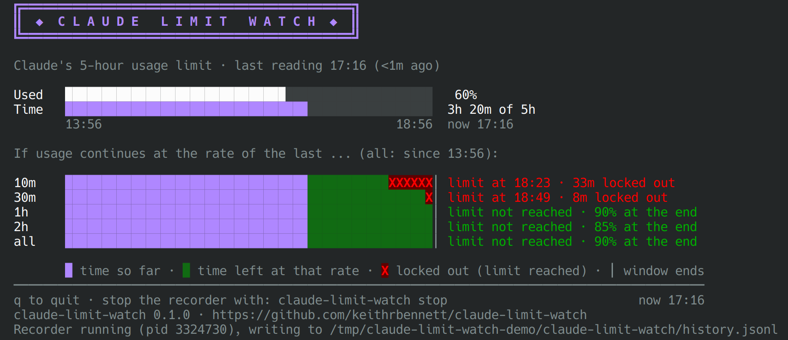

# claude-limit-watch

Watch your Claude subscription's 5-hour usage limit from the terminal. It
records your usage over time and projects when you will reach the limit.

**Unofficial.** claude-limit-watch isn't made, endorsed or supported by
Anthropic. It reads your usage from an undocumented endpoint, which may
change or stop working at any time. It uses the OAuth token Claude Code
stores on your machine, and sends it only to `api.anthropic.com`.

## Installation

    gem install claude-limit-watch

It needs Ruby 2.6 or later and uses only the standard library, so it runs
on macOS's system Ruby.

### Platforms

Linux and macOS are supported; CI tests both, on Ruby 2.6 through 4.0.
WSL on Windows is expected to work but isn't tested.

To use it in WSL, Claude Code must be signed in inside WSL, because
claude-limit-watch reads the credentials from `~/.claude/.credentials.json`
there.

Native Windows isn't supported, because the viewer starts the recorder with
`nohup` in its own Unix process group, and the panel reads keys through
`stty`.

## Usage

    claude-limit-watch [view] [rate-window-minutes]
        [--lines] [--once] [--no-record] [--utc] [--file PATH]

`view` is the default command, so normally you just run
`claude-limit-watch`. `claude-limit-watch --help` lists all the commands
and options, and `--version` shows the version.

claude-limit-watch has two parts, which run as separate processes:

- **The recorder** checks your usage every 5 minutes and appends each
  reading to the [history file](#history-file). Only one recorder runs at a
  time for each history file.
- **The viewer** displays the readings from the history file. It never
  contacts the network, so you can close and reopen it at any time without
  losing history.

When the viewer starts, it starts a recorder in the background if one
isn't already running (unless you pass `--no-record` or `--once`). The
recorder is started with `nohup` in its own process group, so it keeps
running after you quit the viewer or close its terminal.

In a terminal, the viewer shows a full-screen [panel](#panel). With
`--lines`, or when its output isn't a terminal, it prints
[one line per reading](#line-output) instead.

### Options

- **rate-window-minutes** (default 30): how far back the burn rate looks in
  `--lines` output. On the panel, if it isn't 10, 30, 60 or 120, it
  adds a row to the projection bars.
- **`--lines`**: print one line per reading instead of the panel.
- **`--once`**: print the panel once, then the version and project page,
  and exit, without starting a recorder. When piped, the output has no
  colors.
- **`--no-record`**: don't start a recorder; just show the history file.
  See [Viewing without recording](#viewing-without-recording).
- **`--utc`**: show times in UTC. See [Times in UTC](#times-in-utc).
- **`--file PATH`**: use a different history file. Every command takes
  this option.

## Panel

The panel takes over the whole terminal window, like `less` or `vim`,
and when you quit, your earlier terminal output is restored. Press **q** or
Ctrl-C to quit; the recorder keeps running.

From top to bottom:

- **Title line**: the name and version, centered on a lavender rule
  (with `--utc`, followed by "times in UTC"). In a narrower terminal the
  name isn't letter-spaced, and in a very narrow one the rule is left
  out, then the version, then the name; "times in UTC" goes last. The
  whole panel fits in a 24-row terminal.
- **Used**: the percentage of the quota used in the current window.
- **Time**: how much of the 5-hour window has passed (in lavender). Below
  it are the window's start and end times, followed by the current time.
- **Projection bars**: one bar per look-back period, showing what happens
  if usage continues at the rate of the last 10 minutes, 30 minutes, 1
  hour or 2 hours (plus your rate window, if it's different). The `all`
  row uses the average rate since the window started. There is no single
  overall projection.
- **Bottom lines**, below a horizontal rule: how to quit and how to stop
  the recorder, then whether the recorder is running, with its pid. On
  the right, after a vertical bar, are the current time and when the
  last reading was. In a terminal too narrow for the bar, they're
  right-aligned without it, or left out if they'd be cut off. The history
  file is on a line of its own because its path can be long. With
  `--once`, the text about quitting is left out, but the current time is
  still shown.

### Reading the projection bars

Each bar uses the same time scale as the Time bar and lines up under it. A
bar has up to three parts, each with its own fill character and color:

| Fill | Color                    | Meaning                                       |
|------|--------------------------|-----------------------------------------------|
| █    | lavender                 | time elapsed so far                           |
| ▒    | green                    | time you can keep working at that rate        |
| X    | bold red on dark red     | time you'd be locked out after the limit      |
| │    |                          | the end of the window                         |

A bar that lasts to the end of the window has only █ and ▒. A bar that
reaches the limit also has X, shown with at least one X whenever there is
any lockout, and its text is red. Because the fill characters differ, you
can tell the parts apart without color.

The text after each bar gives either the time you'd reach the limit and
how long you'd be locked out (`limit at 01:49 · 20m locked out`), or how
much of the quota you'd have used when the window ends
(`limit not reached · 88% at the end`).

If the history doesn't go back as far as a row's look-back period, the row
is labeled with the period it actually covers (for example `1h50m` instead
of `2h`). If there is too little history for a row, the row says so.

### When the panel shows no projections

- **During the first 30 minutes of a window** (`MIN_ELAPSED_MIN`), a single
  line says when projections will start. Usage often spikes at the start
  of a window, because resumed sessions resend their whole conversation.
  A rate measured during those minutes would predict a limit that you
  won't actually reach.
- **At the limit**, with no readings yet, or with no active window, a
  status line replaces the projection bars. At the limit, the line is red
  and shows the reset time.

### Errors

A failed check (for example, an expired token, an HTTP 429 response or a
network error) appears as a yellow line. If readings stop arriving, the
panel says so and suggests what to do; see
[When readings stop](#when-readings-stop).

### Copying from the panel

The panel checks for changes every second, but redraws only when its
text changes. Times are shown to the minute, so this is usually about once
a minute, and you can select and copy text between redraws. To copy the
whole panel, print it once:

    claude-limit-watch --once | xclip -selection clipboard   # pbcopy on macOS

## Line output

With `--lines`, or when output isn't a terminal, the viewer prints the
readings already recorded for the current window, then one line for each
new reading:

    Time  | Level  | Window       | Ends  | Used | 30m Burn Rate           |  Pace | Outlook
    22:49 | WARN   | 2:00 of 5:00 | 01:49 |  33% | 30.0%/h (avg 16.2)      |  1.3x | LIMIT at 01:04 (in 2:15), 0:45 before reset
    23:18 | no reading: rate-limited by the usage endpoint (HTTP 429); try a longer interval

Durations are shown as h:mm. At the limit, the Outlook column shows
`AT LIMIT, resets in h:mm`.

**Pace** is the current rate divided by the rate that would use exactly
the remaining quota by the end of the window. A pace of 1.0x reaches the
limit just as the window ends. For example, using 20% in the first 20
minutes is a pace of about 3.5x.

### Levels

Each line is colored by its level:

- **OK** (green): at this rate, you won't reach the limit before the window
  ends.
- **WARN** (yellow): at this rate, you will reach the limit before the
  window ends.
- **URGENT** (red): you'll reach the limit before the window ends, and
  either the pace is 2x or more or the limit is 20 minutes away or less.
  Also shown when you're at the limit.

The thresholds are constants at the top of
`lib/claude_limit_watch/projection.rb`.

## Colors

Colors come from the 256-color palette (green 34, yellow 136, red 196,
dark red 52, lavender 141, and a dimmer lavender 97 for the title line's
rule), because terminal themes often change the 16 basic colors (showing
yellow as orange, for example). The exception is the gray used for
secondary text: it is the basic "bright black", which themes change to
their own muted text color.

Set the `NO_COLOR` environment variable to turn colors off.

## Viewing without recording

    claude-limit-watch --no-record

The viewer shows the history file without starting a recorder. Use this
for a history file that nothing should record to, such as a copy from
another machine, a demo file, or any file you open with `--file` just to
look at it.

A recorder that is already running keeps running, and the viewer still
shows whether one is running. If readings stop, the viewer says so, but
doesn't suggest starting a recorder. `--once` behaves the same way.

## Times in UTC

    claude-limit-watch --utc

Shows all times in UTC instead of local time. Local time, the default, has
no marker. With UTC:

- the panel's title line says so once for all times
  (`v0.2.0 · times in UTC`);
- `--lines` output prints `Times are in UTC.` before the readings.

`record --utc` does the same for the recorder's own output. A recorder that
the viewer starts uses the viewer's setting for as long as it runs.

This option changes only what's displayed. The history file is the same
either way, because its times include their UTC offsets.

## The recorder

### Running the recorder yourself

    claude-limit-watch record [interval-minutes] [--utc] [--file PATH]

Runs the recorder in the foreground, printing one short line per reading.
Press Ctrl-C to stop it.

Use this to check at a different interval. The default is 5 minutes; the
minimum is 0.5, and fractions are allowed. Start the recorder before the
viewer, and the viewer will use it instead of starting its own. The viewer
finds the recorder by its history file, so if you use `--file`, give both
commands the same path.

The minimum exists because checking every few seconds gets HTTP 429 (Too
Many Requests) responses from the usage endpoint. The endpoint's actual
rate limit isn't documented.

### Stopping the recorder

    claude-limit-watch stop

`stop` finds the recorder by its history file. If you use a history file
other than the default, give `stop` the same file:

    claude-limit-watch stop --file PATH

You don't need to remember this command. The bottom of the panel shows
how to stop the recorder, and when you quit the viewer, it prints the
command again so it stays in your scrollback. For a non-default history
file, the printed command includes `--file PATH`. The panel's footer has
no room for a command with a path, so for such a file it shows
`kill <pid>` instead, which works for any recorder.

### When readings stop

The viewer starts a recorder only when the viewer itself starts. If the
recorder stops while the viewer is open, the viewer reports that readings
have stopped, and suggests one of the following:

- **No recorder is running**: restart the viewer to start a new recorder.
  If a new recorder fails to start, see `recorder.log`, in the same
  directory as the history file.
- **A recorder is running, but readings have stopped anyway**: check the
  recorder's output. For a recorder the viewer started, that's
  `recorder.log`.

With `--no-record` or `--once`, the viewer only reports that readings have
stopped.

## History file

The default history file is
`~/.local/state/claude-limit-watch/history.jsonl`, or
`$XDG_STATE_HOME/claude-limit-watch/history.jsonl` if `XDG_STATE_HOME` is
set. Every command takes `--file PATH` to use a different file. A recorder
that the viewer starts uses the viewer's history file.

The file is in JSON Lines format: one JSON object per reading. Readings are
only ever appended, so the viewer never sees a partly rewritten file.

    {"t":"2026-11-17T23:19:47+08:00","interval_min":5.0,"util":46.0,"resets_at":"2026-11-17T18:09:59Z"}
    {"t":"2026-11-17T23:24:47+08:00","interval_min":5.0,"error":"HTTP 429 from usage endpoint"}

The recorder deletes readings older than 7 days. A background recorder
writes its output to `recorder.log`, in the same directory as the history
file.

## Upgrading

    gem update claude-limit-watch
    claude-limit-watch stop

A running recorder keeps running the version it started with, and a new
viewer uses the running recorder instead of starting its own. So after
updating, stop the recorder (see
[Stopping the recorder](#stopping-the-recorder)); the next viewer you start
will start a recorder running the new version.

## How it works

- **Data source**: `https://api.anthropic.com/api/oauth/usage`. This
  endpoint is undocumented; the claude-dashboard status line also uses it.
  Requests are authenticated with Claude Code's OAuth token, which is read
  from `~/.claude/.credentials.json` on Linux, or from the
  `Claude Code-credentials` Keychain item on macOS. The first Keychain read
  may ask for permission.
- **Scope**: utilization is account-wide. It includes every Claude Code
  session running at the same time, and any other tools that use your
  Claude login.
- **History**: the endpoint returns only the current utilization and the
  window's reset time. All history comes from the recorder's own readings.
- **Rate over the last N minutes**: calculated from the reading closest to
  N minutes ago. That reading may be up to 10% older than N minutes (at
  least 1 minute older is always allowed). The history must cover at least
  3/4 of N minutes, or the rate isn't calculated.
- **Window average**: utilization divided by the time since the window
  started (the reset time minus 5 hours). The `all` row uses it, and so
  does `--lines` output until there's enough history for the rate window.
- **Precision**: utilization is reported in whole percentage points, so
  rates over short periods are coarse. Over 10 minutes, a change of one
  point is a rate of 6%/h.
- **Expired tokens**: if no Claude Code session has run for a while, the
  token may have expired. The recorder logs an error for each check until
  Claude Code refreshes the token.

## Contributing

Bug reports and suggestions are welcome. Please open an issue and get
approval before submitting a pull request; see
[CONTRIBUTING.md](CONTRIBUTING.md) for details.

## Development

    bundle install
    bundle exec rake          # run the specs (RSpec)
    bundle exec rake rubocop  # check the style (needs Ruby 2.7 or later)
    bin/setup-hooks           # optional: run both before each commit

`bin/setup-hooks` sets git's `core.hooksPath` to the tracked `hooks/`
directory, so the hooks you run are always the committed versions. For this
repository only, that setting overrides any global hooks path and any hooks
in `.git/hooks`.

The pre-commit hook checks the working tree, not just the staged changes,
and skips RuboCop on Ruby 2.6. To skip the hook for one commit, use
`git commit --no-verify`. To turn it off, run
`git config --unset core.hooksPath`.

On Ruby 3.2 or later, the specs also write a SimpleCov line and branch
coverage report to `coverage/` (gitignored): `index.html`, and
`coverage.json` for [cov-loupe](https://github.com/keithrbennett/cov-loupe).
They skip it, with a warning, if SimpleCov can't be loaded or is older
than 1.0, or if `coverage/` can't be written.

To release, follow [docs/dev/RELEASING.md](docs/dev/RELEASING.md), which
uses `bin/pre-release-check`.

CI (`.github/workflows/ci.yml`) runs the specs on Ruby 2.6 through 4.0, on
Linux and macOS, runs RuboCop in a separate job on Ruby 4.0, and checks the
Markdown files' relative links and anchors with
[lychee](https://github.com/lycheeverse/lychee). To run that check locally,
with Docker:

    docker run --rm -v "$PWD":/input:ro -w /input lycheeverse/lychee:0.24.2 \
      --offline --include-fragments --no-progress --extensions md .

`ruby script/demo_history.rb` writes an invented history file for taking
screenshots; see the comment at the top of the script for details.

## License

MIT; see [LICENSE](LICENSE).
